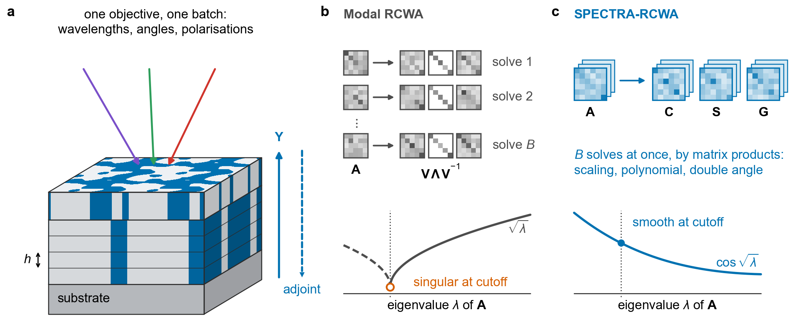
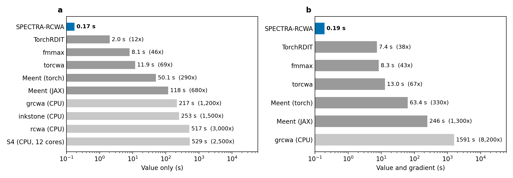
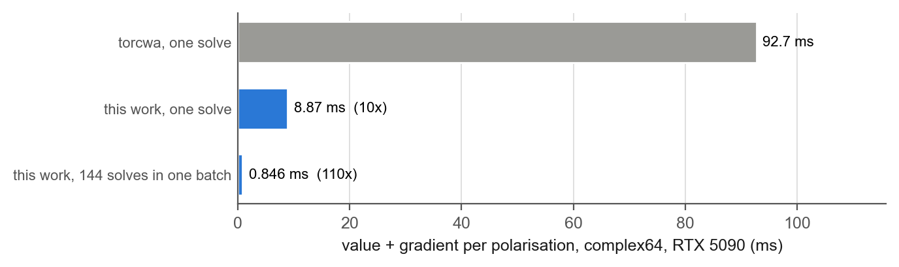
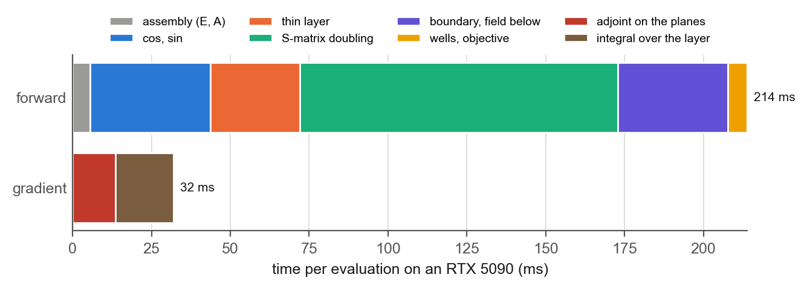

# SPECTRA-RCWA: Differentiable GPU RCWA Solver for PyTorch

[](https://pypi.org/project/spectra-rcwa/)
[](https://pypi.org/project/spectra-rcwa/)
[](https://doi.org/10.5281/zenodo.24459563)
[](https://pypi.org/project/spectra-rcwa/)
[](https://github.com/hyoseokp/spectra-rcwa/blob/main/LICENSE)
[](https://arxiv.org/abs/2611.30305)

**Eigendecomposition-free, GPU-batched RCWA with adjoint gradients: 144 solves with gradients in 0.19 s on one RTX 5090, at least 38 times faster than the other GPU RCWA codes we tested.**



**Figure 1: One objective over many wavelengths, angles and polarisations as one batch of matrix products, with no eigendecomposition.** (a) A periodic stack of patterned layers, each cut into steps of thickness h. All wavelengths, incidence angles and both polarisations of an objective are solved as one batch; the admittance Y is swept up the stack and the adjoint field down it, which gives the gradient with respect to every pattern value. (b) Modal RCWA diagonalises the layer matrix A = PQ, one solve at a time, as VΛV⁻¹; its propagation constants are square roots of the eigenvalues λ, which are singular at the cutoff of an order (λ = 0), and so is the gradient. (c) SPECTRA-RCWA forms C = cos(ωhA^(1/2)), S = sin(ωhA^(1/2))/A^(1/2) and G = (C − I)/A for all B solves at once by matrix products (scaling, a polynomial and double-angle steps). These are entire functions of A, smooth at the cutoff. On one RTX 5090, 144 solves with 578 x 578 layer matrices give value and gradient in 0.19 s.



**Figure 2: Time for 144 solves (9 wavelengths x 16 incidence directions, both polarisations, (8, 8) orders, 578 x 578 layer matrices) of a 0.25 µm freeform layer, one RTX 5090.** (a) Value only. (b) Value and gradient with respect to all 64 x 64 pattern values. Ratios are against SPECTRA-RCWA on the same problem. S4 was measured on a problem of the same size (0.8 µm layer, 128 x 128 values) on 12 CPU cores; its ratio uses SPECTRA-RCWA's value time there (0.21 s). Meent on JAX and the CPU codes were timed on another machine (see the table). Drawn by `scripts/make_speed_bar.py` from `benchmarks/results/`.

| code | device, precision | value (s) | value + gradient (s) | max error of T00 | peak memory (GiB) |
|---|---|---|---|---|---|
| **SPECTRA-RCWA 1.6.2** | RTX 5090, complex64 | **0.17** | **0.19** | 2.2e-6 | 6.1 |
| TorchRDIT 0.2.0 | RTX 5090, complex64 | 2.0 | 7.4 | 8.4e-6 † | 18.9 |
| fmmax 1.7.1 (FFT formulation) | RTX 5090, complex64 | 8.1 | 8.3 | 1.1e-3 ‡ | 10.9 |
| torcwa 0.1.4.2 | RTX 5090, complex64 | 11.9 | 13.0 | 1.7e-5 | 2.0 |
| Meent 0.13.2 (torch) | RTX 5090, complex128 | 50 * | 63 * | 5.7e-3 § | 4.7 |
| Meent 0.13.2 (JAX) | RTX 5090, complex128 | 118 * ¶ | 246 * ¶ | 1.4e-3 § | 0.1 |
| grcwa 0.1.2 | CPU, 4 threads, complex128 | 217 * ¶ | 1591 * ¶ | 2.8e-10 | 7.1 (host) |
| inkstone 0.3.15 | CPU, 4 threads, complex128 | 253 * ¶ | no gradient | 1.9e-2 § | 1.0 (host) |
| rcwa 1.0.48 | CPU, 4 threads, complex128 | 517 * ¶ | no gradient | 2.8e-10 | 1.7 (host) |
| S4 | i7-12700, 12 processes | 529 (other problem, see Figure 2) | no gradient | | |

Error: largest absolute error of the zeroth-order transmission (average of two orthogonal polarisations) over the 144 solves, against a converged complex128 eigendecomposition solution with the Laurent rule and rectangular truncation. \* timed on 16 of the 144 solves (one wavelength, all directions) and multiplied by 9: these codes solve one wavelength and direction per call. † TorchRDIT with the series order of its paper, directions in chunks of 4 to fit 80% of the card; error per polarisation. ‡ comes from complex64 eigendecomposition on the GPU; 8.5e-6 on the CPU. § follows from a different factorisation rule or truncation (Meent: Li's inverse rule; inkstone: circular truncation with exact pixel shapes), not from an error of the code. ¶ timed on 2026-11-23 on a Ryzen 9 7950X machine (with the same GPU for Meent on JAX); the other rows were timed on 2026-11-25 on one machine (RTX 5090, Ryzen 9 9950X). For a 1 µm layer SPECTRA-RCWA takes 0.24 / 0.29 s; fmmax, torcwa and Meent take the same time as at 0.25 µm, and TorchRDIT needs 0.25 µm slices set by hand (4.3 / 13.7 s) for this accuracy. Codes and versions as installed from PyPI on 2026-11-23, each with its documented API and default settings; script: `benchmarks/compare_other_rcwa.py`. Records: `benchmarks/results/`.

SPECTRA-RCWA is an open-source (MIT) solver for periodic layered structures by rigorous coupled-wave analysis (RCWA, also called the Fourier modal method, FMM) that needs no eigendecomposition. It is written in PyTorch, runs many solves as one batch on a GPU (or on the CPU), and returns diffraction efficiencies, fields and the gradient of any objective with respect to every pixel of the pattern from one adjoint field. Use it to simulate and optimise diffraction gratings, metagratings, metasurfaces, photonic-crystal slabs, thin-film stacks and colour routers, in particular when an inverse design needs value and gradient over many wavelengths and incidence angles, for thick or multilayer patterns, or near the cutoff of a diffraction order, where eigendecomposition gradients fail.

If SPECTRA-RCWA is useful to you, a GitHub star helps other researchers find it.

```bash
pip install spectra-rcwa            # or, from source: pip install git+https://github.com/hyoseokp/spectra-rcwa
pip install "spectra-rcwa[mcp]"     # adds the MCP server for AI agents (spectra-rcwa mcp)
```

```python
import math, torch
from spectra_rcwa import ColorRouterForward, Ray, Stack

# lamellar grating: index-2.0 ridges in air, period 1 um, depth 0.5 um, fill factor 0.5; 633 nm at 10 degrees; 41 orders
stack = Stack(period_um=(1.0, 1.0), thickness_um=0.5, density_shape=(512, 1), fourier_orders=(20, 0), eps_design=4.0)
fwd = ColorRouterForward(stack=stack, rays=[Ray(math.radians(10.0), 0.0, 1.0)], wavelengths_nm=[633.0], dtype=torch.complex128)
x = torch.arange(512) / 512                                     # sample positions in periods
rho = ((x >= 0.25) & (x < 0.75)).double()[:, None].requires_grad_()   # density: 1 = ridge, 0 = air
T, R = fwd.efficiencies([(rho, 0.5)])                           # [solves, orders, (p, s)]; order m at index m + 20
print(T[0, 21], T.sum(1) + R.sum(1))                            # +1 order (0.4408, 0.2656); T + R = 1 for a lossless grating
T[0, 21, 0].backward()                                          # rho.grad: d(+1 order, p) / d(density)
```

Measured (complex64 on one RTX 5090 unless named; records in `benchmarks/results/`):

* 144 solves with 578 x 578 layer matrices (16 incidence directions x 9 wavelengths, both polarisations, (8, 8) orders) give the value and the gradient with respect to all 64 x 64 design values of a 0.25 µm layer in 0.19 s (1.3 ms per solve). With a circle of orders instead of a rectangle (`truncation="circular"`), 144 solves of a 0.8 µm layer of 128 x 128 values take 0.15 s at 9 orders (506 x 506) and 0.08 s at 8, against 0.24 s at (8, 8) rectangular.
* Compared with TorchRDIT 0.2.0, another eigendecomposition-free RCWA, on the same problems and GPU at matched accuracy: 38 times less time for value and gradient of a 0.25 µm layer and 46 times for 1 µm, with one third to two thirds of the peak GPU memory (6.1 against 18.9 GiB, 8.7 against 14.0 GiB). SPECTRA-RCWA chooses the number of steps from the layer thickness, so thick layers need no slicing setting.
* On a 144-solve evaluation with 128 x 128 design values (a 0.8 µm layer, 16 directions x 9 wavelengths), value and gradient take 0.244 s, 212 times less than torcwa (51.6 s) on the same GPU. The gradient agrees with a complex128 reference to 2.2e-6, and to 3.3e-5 on a layer with an order at cutoff, where the relative error of torcwa's gradient is 2.5 (0.49 on an earlier machine).
* One solve at a time (one wavelength and direction, both polarisations): 16 ms for the value and 23 ms with the gradient at 578 x 578 layer matrices, 0.10 s at 2178 and 2.2 s at 7442.

Agents: read [AGENTS.md](https://github.com/hyoseokp/spectra-rcwa/blob/main/AGENTS.md), or run `spectra-rcwa mcp` for tools that set up, check and solve a grating problem ([llms.txt](https://github.com/hyoseokp/spectra-rcwa/blob/main/agents/llms.txt)).

[How it works](#what-it-does) · [Install](#install) · [Efficiencies](#diffraction-efficiencies) · [Scope and conventions](#scope-and-conventions) · [Speed and accuracy](#speed-and-accuracy) · [Agents and MCP](#ai-agents-and-mcp) · [Citation](#citation)

SPECTRA-RCWA stands for a spectral propagation engine for coupled-wave theory with recursive admittance.

## What it does

Classical RCWA diagonalises the layer matrix A = PQ and builds the layer S-matrix from the eigenvectors W and
the eigenvalues kz². The S-matrix never needs the eigenvectors themselves: every expression W f(kz) W⁻¹ is a matrix function
of A. Since the fields obey e′ = iωPh and h′ = iωQe (z downward), a step h of a layer needs only functions that are entire
in A, with no square root:

    C = cos(ωh A^(1/2)),   S = sin(ωh A^(1/2)) / A^(1/2),   G = (C − I) / A
    e(0) = C e(h) − iS P h(h),   h(0) = −iQS e(h) + (I + QGP) h(h)

From the output medium upwards, with h(h) = Y e(h):

    D = (C − iSPY)⁻¹,   e(h) = D e(0),   Y_top = (Y + QGPY − iQS) D

This package computes

* **C, S and G** by scaling, a degree-6 polynomial in A (Paterson–Stockmeyer, four GEMMs) and double-angle steps on C − I, which unlike
  steps on C lose no digits while the argument is small: GEMMs only (`spectra_rcwa.matfun.cos_sinc`). A batch of GEMMs is one cuBLAS call; a single large complex64 product, and complex128 ones on a GeForce, run as three real products (`spectra_rcwa.kernels.product`);
* **the recursion** with one batched inverse per step and an output-to-input pass over two right-hand sides; the topmost step needs no inverse, only LU factors for two right-hand sides. An evanescent
  order makes C and S large, so a layer is cut in steps with ωh max(k) at most 4.5 (`SolverConfig.max_step_phase`): 3 steps for
  0.25 µm at (8, 8) orders;
* **for a layer of 5 steps or more** (`SolverConfig.block_from_steps`; 0.6 µm at (8, 8) orders) its S-matrix instead: one thin step (at most 6.5) in the
  wave basis of a fixed reference admittance, then Redheffer products of the layer with itself, r doublings for 2^r steps with
  r + 1 inverses (`spectra_rcwa.blocks`); neighbouring layers of this kind hand over their reflection matrix, without an admittance in between;
* **a uniform layer of a JSON problem** in closed form per order, since it does not couple the orders (`ColorRouterForward.uniform_block`);
* **the gradient from one adjoint field** (`spectra_rcwa.adjoint`), with no graph. The objective needs the field for two incident polarisations only, and for a variation of P and Q

      dJ = Re ∫ iω (a^H dP h + b^H dQ e) dz,   a' = iω Q^H b,   b' = iω P^H a

  with a = V_i^H b at the top of the stack and a + V_o^H b = dJ/d(field below) at its bottom. The factors saved by the forward pass give (e, h) and (a, b) on the planes between the steps, stable in both directions, in products with
  two columns; a short Taylor series from each plane gives them on Gauss–Legendre nodes, and the integral is a low-rank sum;
* **P and Q by structure**: P = J + K_L E⁻¹ K_R and Q = −K_L K_R + [[0, −E], [E, 0]] with K_R K_L = 0, so A = PQ needs two GEMMs of a quarter of the size, a product with P costs a quarter of a dense GEMM and one with Q half of it. The elementwise parts run as single NVRTC passes (`spectra_rcwa.kernels`).

There is no eigensolver, no square root, no branch choice and no P⁻¹. All solves of an evaluation go into one batch on the GPU,
the gradient has neither 1/(λi − λj) nor 1/√λ terms, and a layer order at cutoff (λ near 0) needs no special handling. In complex128 the adjoint field agrees with autograd through the same forward pass to about 1e-14.
`AUTOGRAD_ROUTE` switches off the adjoint field, for comparison: autograd through dense P and Q (the products by structure run without a graph only), pivoted inverses, degree 8, the route of the commit before them.

### Thick layers and stored layers

A layer's S-matrix depends on that layer alone, so it can be kept, for instance for a layer stack below a design that does not change:

```python
with torch.no_grad():                                  # a stored layer needs no graph
    pd = fwd.layer_block(rho_pd, 3.0)                  # (T, R), each [solves, 2N, 2N], in a fixed reference basis
below = fwd.stack_field([(rho_a, 0.25), (rho_b, 0.25), pd])                  # field below the stack, [solves, 2N, 2]
below, top = fwd.stack_field([(rho_a, 0.25), pd], return_top=True)           # and at the top of it
```

The reference medium is a fictitious lossy one (ε = 4 + 4i), so I − RR has no real pole at a guided mode of the layer and no order has a
Rayleigh point in it, unlike a vacuum basis. Both routes against complex128 through Γ with 14 iterations, which they match to 6.5e-13 in complex128
(complex64; RTX 5090; (8, 8) orders, 540 nm; errors for one ray, time and memory for 16 rays in one batch):

| layer | route | value error | gradient error | T and R error | time per solve (ms) | memory per solve (MiB) |
|---|---|---|---|---|---|---|
| SiN 0.8 µm | recursion, 7 steps | 2.9e-08 | 2.9e-05 | 2.7e-06 | 4.5 | 60 |
| SiN 0.8 µm | doubling, 8 steps | 9.4e-08 | 9.8e-06 | 8.8e-06 | 2.7 | 51 |
| SiN 1.5 µm | recursion, 12 steps | 2.3e-08 | 3.2e-05 | 8.9e-07 | 8.2 | 95 |
| SiN 1.5 µm | doubling, 16 steps | 2.3e-08 | 1.6e-05 | 4.1e-06 | 3.0 | 63 |
| SiN 3 µm | recursion, 24 steps | 5.9e-08 | 6.3e-05 | 4.2e-06 | 15.3 | 168 |
| SiN 3 µm | doubling, 32 steps | < 1e-09 | 4.4e-05 | 4.3e-06 | 3.4 | 81 |
| Si (ε = 17.1 + 0.28i) with a 0.2 µm oxide trench, 3 µm | recursion, 24 steps | 1.7e-07 | 5.9e-05 | 1.6e-05 | 15.5 | 172 |
| Si (ε = 17.1 + 0.28i) with a 0.2 µm oxide trench, 3 µm | doubling, 32 steps | 1.4e-08 | 8.7e-05 | 5.2e-06 | 3.6 | 85 |

The absorbing layer has A = 0.7149 and 0.7143 (reference 0.7149 and 0.7143) for the two polarisations, with A = 1 − T − R from the fluxes; in the lossless layers
that A is at most 8.8e-06. Central differences of complex128 along the adjoint gradient at 3 µm: 0.0094546 against its norm 0.0094547 (SiN, recursion and doubling), 0.0051844 against 0.0051847 (Si, doubling).
Per solve, doubling is faster from 2 or 3 steps on (5.5 against 4.1 ms at 3 steps and 8.9 against 4.9 ms at 7, in a stack of two), but a thin layer needs fewer matrices for the gradient through the recursion when it is one of many, so a layer goes through its S-matrix from 5 steps on (from 7 up to version 1.5, with a smaller thin step).

### Option: the route through Γ, before the patch

`SolverConfig(boundary="direct", boundary_inverse="block")` is the earlier route, before the entire functions, kept as an option and as a check, and `boundary="smatrix"` with `REFERENCE_C128` its converged
complex128 reference. Γ = A^(1/2) (branch Im kz ≥ 0) comes from the product form of the Denman–Beavers iteration with norm scaling
μ = (‖M⁻¹‖ / ‖M‖)^(1/4), the exact identity Y₀M₀⁻¹ = I in the first step, and a third-order series for M^(−1/2) at the end (4 batched
inverses plus GEMMs); E = exp(iωdΓ) from scaling and squaring with a degree-18 Taylor polynomial; the boundary conditions from a
2 x 2 block system eliminated with two inverses and an adjoint written by hand with O(n²r) work beyond the saved inverses
(r = 2 polarisations). The CUDA path adds hand-written backward passes for the Denman–Beavers steps and the squarings, NVRTC-compiled
fused kernels for linear combinations and for K_i = P Y_i, K_o = P Y_o, a sync-free pivoted batched LU, and a block-recursive (GEMM-only)
inverse for the well-conditioned matrices (`spectra_rcwa.kernels`). Everything falls back to plain PyTorch on the CPU.

This route is not reliable at an order at cutoff, because Γ is not analytic at λ = 0. Value and gradient are smooth there only through
cancellations: if P has the small singular value (about |λ|), the adjoints of P through A = PQ and through K = PY each grow as 1/|λ| and
sum to O(1). That needs Γ² = PQ far below the rounding error of a complex64 A, so computing Γ and E alone in complex128 does not help,
and an iteration converged for λ, which 4 Denman–Beavers steps are not at any precision; with a small complex pair of eigenvalues 4 steps
give a wrong value with no sign of it (T = 0.76 where the converged value is 0.96). The relative gradient error grows as 1/λ². On an 8-layer
design about one layer solve in 288 has ‖A⁻¹‖_F above 1e6, and such a solve can dominate the gradient of the whole evaluation. That is why the default changed. Default route (this work) against the route through Γ on an RTX 5090:

| design | route | value + gradient (s) | peak memory (GiB) | value error | gradient error (rel. L2) |
|---|---|---|---|---|---|
| grey, 144 solves, the objective | default | 0.244 | 7.0 | 3.0e-06 (Tabs) | 2.2e-06 |
| same | through Γ | 0.423 | 15.9 | 6.3e-06 (Tabs) | 8.1e-04 |
| binary, 144 solves, the objective | default | 0.254 | 7.0 | 3.3e-06 (Tabs) | 8.3e-06 |
| same | through Γ | 0.423 | 15.9 | 1.7e-05 (Tabs) | 3.1e-03 |
| one layer of an 8-layer SiN/SiO2 design, 0.25 µm, 144 solves, the objective, with a solve at ‖A⁻¹‖_F = 4.5e6 | default | 0.162 | 5.4 | 1.3e-06 (Tabs) | 3.3e-05 |
| same | through Γ | 0.389 | 14.8 | 3.9e-06 (Tabs) | 3.3e-01 |
| that 8-layer design, `MultiLayerForward`, random weights on Tabs, 16 rays at 420 nm | default | 0.28 | 3.1 | 9.3e-06 | 3.2e-05 |
| same | through Γ, no TF32 | 1.9 | 15.2 | 1.2e-05 | 1.8e-02 |

On the third case, central differences of complex128 along the gradient give 0.000665 against its norm 0.000665 for the reference, 0.000665 against 0.000665 for the default route, and 0.000629 against 0.000676 for the route through Γ.

Older measurements, kept in `benchmarks/results/summary.json`: the route through Γ on an H200 (0.386 s complex64, 0.822 s complex128) and an RTX 5880 Ada (0.858 s); not measured again on those.

## Install

```bash
pip install spectra-rcwa              # or pip install git+https://github.com/hyoseokp/spectra-rcwa
pip install "spectra-rcwa[mcp]"       # the MCP server for agents
```

From a checkout:

```bash
pip install -e .            # torch >= 2.6 and numpy; complex64 on CUDA needs torch >= 2.8
pip install -e ".[test]"    # pytest
pip install -e ".[figures]" # matplotlib, for scripts/make_figures.py
```

The NVRTC kernels of the complex64 CUDA path use `torch.cuda._compile_kernel` (torch 2.8 or newer; tested with 2.10.0), and the CPU and complex128 run on plain torch; the torch wheel is enough, no CUDA toolkit or `CUDA_HOME` is needed. If the cuBLAS library that
torch loaded is not found automatically, set `SPECTRA_RCWA_CUBLAS` to its path.

## Minimal example

```python
import torch
from spectra_rcwa import ColorRouterForward, Stack, shifted_disk_pupil, value_and_grad

stack = Stack(period_um=(2.0, 2.0), thickness_um=0.8, density_shape=(64, 64), fourier_orders=(4, 4),
              eps_design=2.05 ** 2, eps_fill=1.0, eps_in=1.0, eps_out=1.46 ** 2, detector_z_um=1.25)
rays = shifted_disk_pupil(numerical_aperture=0.30, chief_ray_angle_deg=2.5, chief_ray_azimuth_deg=22.5)
fwd = ColorRouterForward(stack=stack, rays=rays, wavelengths_nm=(450.0, 540.0, 630.0))     # on the GPU if there is one

density = torch.rand(64, 64)
tabs = fwd.response(density.to(fwd.device))   # Tabs[well (R, G2, G1, B), wavelength], float64, differentiable
target = torch.eye(4, 3, dtype=torch.float64)
tabs, value, grad = value_and_grad(fwd, density, lambda t: (t * target).sum())
```

`examples/minimal.py` runs a smaller case of it on CPU or GPU. Permittivities can be numbers or functions of the wavelength
in µm. `SolverConfig` holds the solver options; `DEFAULT` is the configuration used for every number below, and
`REFERENCE_C128` is a converged complex128 configuration used as the accuracy reference.

### Diffraction efficiencies

`ColorRouterForward.efficiencies(layers)` returns (T, R), the power in every diffraction order of the substrate and of the superstrate over
the incident power, `[solves, N, 2]` with one column per incident polarisation, for any stack that `stack_field` takes; `stack_field` itself
returns the tangential electric field below and on top of the stack. Tabs, the table of the four detector quadrants, is the output that the
colour-router objective uses.

```python
t, r = fwd.efficiencies([(rho_a, 0.25), (rho_b, 0.25)])      # order (m, n) at index (m + M) * (2 N + 1) + (n + N)
```

### Scope and conventions

* Rectangular lattices with periods along x and y, and oblique ones: `lattice_angle_deg` is the angle between a1 = (Λx, 0) and a2 (60 or 120 with
  equal periods is hexagonal). An oblique lattice keeps a circle of orders (`truncation="circular"`), so a hexagonal pattern keeps its symmetry, has
  no Li rule, needs orders along both vectors and has no wells. The two periods, the two order counts and the two sides of the design grid can differ, and
  `fourier_orders=(M, 0)` is a 1D grating. On a rectangular lattice all (2M + 1)(2N + 1) orders are kept. E⁻¹ in P is the inverse of the Laurent matrix. For the in-plane
  components a 1D grating uses Li's inverse rule, so TE and TM converge alike; a crossed grating uses the Laurent rule by default, as in torcwa,
  and Li's rules with `SolverConfig(factorization="li")`. `SolverConfig(factorization="normal")` uses a smooth normal tensor of the pattern; for smooth
  shapes of high index it needs far fewer orders: on a silicon pillar (period 0.5 µm, 633 nm) its largest efficiency error is 9.6e-3 at 226 x 226
  and 4.3e-3 at 394 x 394 matrices, against 6.3e-2 at 394 x 394 and 1.6e-2 at 3586 x 3586 with Laurent. It does not help where the orders cannot resolve the
  features or the waves in the pattern. Metals and other high-contrast patterns converge slowly in the orders.
* A pattern mixes two isotropic, non-magnetic materials linearly through the density, and `MultiLayerForward` uses the same two in every layer; a
  uniform layer is density 0 or 1, or `uniform_block(eps, thickness_um)` for any permittivity. A patterned layer of other materials goes into `stack_field` as the `layer_block` of a second forward with the same
  lattice, orders, rays and wavelengths.
* The time dependence is exp(−iωt), so absorption is Im ε > 0. Lengths are in µm, wavelengths in nm and `Ray` angles in radians (polar angle from
  z in the reference medium, azimuth from x). Light comes from the superstrate, which is lossless. The two columns of a field are the
  polarisations p cos φ − s sin φ and p sin φ + s cos φ, which are x and y at normal incidence.
* `density[i, j]` is the sample at x = iΛx/H, y = jΛy/W (band-limited samples, first index along x), with H and W at least 4 × orders + 1.
  In a JSON problem, `solve` uses exact Fourier coefficients instead of samples for lamellar layers, for rectangles and disks of a crossed grating,
  and for arrays with `pixels: true`; `convergence_in_orders` with a `tolerance` raises the orders until the efficiencies settle.
  The detector samples sit at (k + 0.5)Λ/S, and a well is its share of |E|² on the detector plane, a midpoint rule on `detector_samples`, times the
  total transmission.
* Every solve runs at the frequency (1 + `rayleigh_nudge`)/λ, 1e-4 by default, so that no order of the half-spaces sits on a Rayleigh point; π is
  torcwa's 3.141592652589793, to match it digit for digit.
* On CUDA the solver selects MAGMA for the process (`SolverConfig.linalg_library`; an empty string leaves the setting alone); its own LU factorisations and inverses run in cuSOLVER or in the kernels of the package. It expects TF32
  products off, which is torch's default. One GPU per process: the kernels belong to the current CUDA device.
* The factors of a solve live as long as its graph. In a loop, drop the outputs of the last evaluation (`del tabs, loss`, or evaluate inside a
  function, as `value_and_grad` does) before the next forward; otherwise two sets of factors are held at once.

### Multi-layer stack

`MultiLayerForward(thicknesses_um=(...), ...)` stacks several patterned layers (density `[layers, H, W]`), with the admittance
recursion above running through all of them. The tests check that one layer equals the direct boundary solve and that two layers of
thickness d/2 equal one layer of thickness d. With the routes through Γ the layers are combined by Redheffer products in a vacuum gap basis,
which puts real poles at guided modes of the layers. `chunk` bounds the solves per batch, and `responses` takes several stacks `[S, layers, H, W]`.

On an RTX 5090, value + gradient for 2 µm of total thickness, 144 solves in one batch unless named, the objective:

| layers | layer thickness (µm) | solves per chunk | value + gradient (s) | peak memory (GiB) |
|---|---|---|---|---|
| 1 | 2 | 144 | 0.324 | 9.0 |
| 2 | 1 | 144 | 0.520 | 12.5 |
| 4 | 0.5 | 144 | 0.848 | 18.5 |
| 8 | 0.25 | 144 | 1.39 | 28.0 |

A real 8-layer design of 128 x 128 per layer takes 1.39 s and 28.0 GiB for 144 solves. Its exact mirrors (i to 128 − i on the design grid, and x and y exchanged), with the rays and wells mirrored, give the same Tabs to 4.4e-06.

## Speed and accuracy

One evaluation = a colour-router objective on Tabs (not part of this package) and its gradient with respect to all 128 x 128 density values, 16 rays (NA 0.30,
CRA 2.5°) x 9 wavelengths = 144 solves, each for both polarisations, (8, 8) Fourier orders (578 x 578 layer matrices), 800 nm SiN layer, grey design unless named, complex64. Errors are against complex128 through Γ with 14 iterations, solved one ray at a time.

| | S4 (CPU) | torcwa (GPU) | **this work (GPU)** |
|---|---|---|---|
| hardware | i7-12700, 12 processes | RTX 5090 | RTX 5090 |
| value (s) | 529 | 24.1 | **0.213** |
| value, speed-up against S4 on 12 processes | 1x | 22x | **2,490x** |
| value + gradient (s) | no gradient | 51.6 | **0.244** |
| value + gradient, against this work | | 212x | 1x |
| per solve, value + gradient (ms) | | 358 | **1.69** |
| peak GPU memory (GiB) | | 4.8 | **7.0** |
| Tabs error (max rel.), grey | 3.4e-02 from torcwa | 8.9e-06 | **3.0e-06** |
| gradient error (rel. L2), grey | | 5.9e-03 | **2.2e-06** |
| gradient error, binary | | 4.6e-02 | **8.3e-06** |
| gradient error, a layer with an order at cutoff | | 2.5 | **3.3e-05** |

All measured. S4 was run once, on the CPU named, and gives the value only: 5238 s in a single process (24,600x against this work, 2,490x on 12 processes, on different hardware); it agrees with torcwa on the transmission to 1.7e-04. torcwa runs its solves one by one, each polarisation separately, with torch's default linear algebra library, 1 to 4 CPU threads for the eigendecomposition (the thread count hardly matters: 24.1 s with 1, 24.2 s with 4), and a checkpoint per wavelength for the gradient: the graph of 288 solves would hold 41 GiB. Sharing the eigendecomposition between the polarisations brings its value to 12.5 s, but that path is not differentiable. With MAGMA selected for the whole process, as the default route of this package does, its value pass takes 51.4 s. In complex128, in chunks of 24 solves, this work takes 15.0 s and gives the objective to 1.3e-15.

TF32 costs far more accuracy than time at every stage of this route (worst gradient error of six cases, against 8.7e-05 without): cos sin 1.2e-02 at 230 ms, thin step 8.2e-02 at 237 ms, doubling 1.8e-02 at 202 ms, below block 3.3e-04 at 239 ms, inverses 9.5e-03 at 233 ms, adjoint planes 1.7e-03 at 245 ms, adjoint integral 2.8e-04 at 244 ms, adjoint whole 2.7e-03 at 243 ms, against 245 ms, so it is off. The six cases are grey, binary, the layer at cutoff, the 8-layer design, 3 µm of SiN and 3 µm of Si with a trench.

### Single solve

Value + gradient per polarisation, complex64 on the RTX 5090. One solve of torcwa takes 93 ms and of this work, for both polarisations, 18 ms; in the batch a solve costs 1.7 ms.



Large single solves: one wavelength and direction, both polarisations, complex64 on the RTX 5090, through `solve` and `gradient` of a JSON problem (a 0.5 µm layer of random 100 nm pixels, period 10 µm in 1D and 2 µm in 2D):

| orders | layer matrix | value (s) | value + gradient (s) | peak memory of the value (GiB) |
|---|---|---|---|---|
| (16, 16) | 2178 | 0.10 | 0.11 | 0.6 |
| (800, 0) | 3202 | 0.36 | 0.42 | 1.4 |
| (20, 20) | 3362 | 0.26 | 0.27 | 1.5 |
| (24, 24) | 4802 | 0.70 | 0.72 | 3.0 |
| (1200, 0) | 4802 | 0.94 | 1.12 | 3.0 |
| (30, 30) | 7442 | 2.16 | 2.23 | 7.1 |

### Where the time goes



One evaluation of the 800 nm layer on the RTX 5090 (forward 214 ms, gradient 32 ms, timed stage by stage).

### Hardware

* **RTX 5090** (32 GB), AMD Ryzen 9 9950X 16-Core Processor, torch 2.10.0+cu128, driver 595.112.07, 2026-11-25: every number of this work (version 1.6.2) and torcwa 0.1.4.2 above, unless named otherwise. The single solve of this work in the figure is of version 1.6.1, in the same session.
* **RTX 4090** (24 GB), an earlier version, same torch: the same evaluation takes 0.391 s (0.297 s for the value) and 6.6 GiB, gradient error 2.7e-06; 8 layers, 144 solves, in chunks of 36 (a value pass, then a forward and gradient pass per chunk) take 4.76 s and 13.1 GiB (`benchmarks/results/rtx4090.json`).
* **S4** (Python extension built from source with OpenBLAS), Ubuntu 22.04 under WSL2 on an i7-12700 (12 cores).

## Tests

```bash
pytest
```

CPU tests (complex128 and complex64): the entire functions, matrix square root and exponential against eigendecomposition and
`torch.linalg.matrix_exp`; hand-written backward of the Denman–Beavers step and of the squarings against
autograd; block-recursive inverse; direct boundary solve against the reference formula, the S-matrix route and
eigendecomposition RCWA (air and glass superstrate); its adjoint against autograd and `gradcheck`; one layer
equals two half layers; full response against eigendecomposition RCWA; central finite-difference gradient checks
in complex128 (single and multi-layer); solves tuned to an eigenvalue 1e-6 with P or with Q nearly singular (one layer, a stack, a batch with
one such solve), against complex128 on both sides of the cutoff. CUDA tests (fused kernels against torch, pivoted and block inverses,
hand-written backward on the GPU, complex64 GPU response and a solve at cutoff against the complex128 CPU reference) are skipped
without a GPU. `tests/test_adjoint.py`: the adjoint field against autograd in complex128 (recursion, doubling, stacks, both outputs of a solve, stored blocks) and complex64, on the CPU and the GPU, the kernels, and the exact mirrors of the lattice in a batch of 48 solves. `tests/test_general.py`: diffraction efficiencies against energy conservation and the Airy formula of a slab, a rectangular cell with unequal orders and a 1D grating, the adjoint for a layer index above the largest transverse wave vector, the checks on the arguments, chunks, the energy guard, and large matrices after `torch.set_num_threads`.

`torch.linalg.solve_triangular` gives wrong results for a complex64 batch of 16 or more with the factors of a matrix that needs pivoting (residual about 7 instead of 1e-3; 578 x 578, torch 2.10.0+cu128, RTX 5090, with the library set to MAGMA or left at its default; a batch of 8 or less is right, and so are diagonally dominant matrices). The routes here do not call it: `spectra_rcwa.kernels.pivlu.lu_solve` has its own triangular solves. `tests/test_cuda.py` measures the residual of every batched solver the routes use at a batch of 144 and 288, and keeps this case as an expected failure.

## Reproducing the benchmarks

`benchmarks/results/` holds the measurements behind the tables and figures here: `rtx5090.json` and `rtx5090_stages.json` for this work (`rtx4090*.json` on the RTX 4090), `rtx5090_torcwa.json`, `large_single_solves_rtx5090.json`, `summary.json` for S4 and the older measurements, `route_through_gamma_failures.json` for the failure described above, `solve_triangular_residuals.json` for the note on `solve_triangular`, and `torchrdit_rtx5090_025um.json` and `torchrdit_rtx5090_1um.json` for the comparison with TorchRDIT 0.2.0 at the top of this page. They were measured with a colour-router objective, design files and comparison code that are not distributed here. `python scripts/make_figures.py` regenerates `docs/figures/` from these files.

`benchmarks/bench_synthetic.py` runs a problem of the same size (144 solves, (8, 8) orders, 128 x 128 design values, 0.8 µm layer) on a synthetic freeform pattern with a fixed linear objective, using nothing outside this package, and reports time, peak memory and the error against complex128 for one ray:

```bash
cd benchmarks
python bench_synthetic.py results/synthetic.json            # on the GPU if there is one
python bench_synthetic.py synthetic_small.json --small      # a small case for a CPU
```

## AI agents and MCP

[AGENTS.md](https://github.com/hyoseokp/spectra-rcwa/blob/main/AGENTS.md) tells an agent when the package fits, how to set up a problem, how to check it and which pitfalls to avoid; [llms.txt](https://github.com/hyoseokp/spectra-rcwa/blob/main/agents/llms.txt) and [llms-full.txt](https://github.com/hyoseokp/spectra-rcwa/blob/main/agents/llms-full.txt) are the same material for language models. The command line takes problems as JSON:

```bash
spectra-rcwa example lamellar_grating > grating.json     # also pillar_array, hexagonal_pillars, slab, two_layer_grating
spectra-rcwa check grating.json                          # errors, warnings, size
spectra-rcwa solve grating.json                          # efficiencies of every propagating order, p and s
```

`spectra-rcwa mcp` serves seven tools over stdio (`pip install "spectra-rcwa[mcp]"`): `environment`, `example_problem`, `problem_schema`, `validate_problem`, `solve_efficiencies`, `efficiency_gradient` and `convergence_in_orders`. Register it in any MCP client as the command `spectra-rcwa` with the argument `mcp`:

```bash
claude mcp add spectra-rcwa -- spectra-rcwa mcp                                   # Claude Code
codex mcp add spectra-rcwa -- spectra-rcwa mcp                                    # OpenAI Codex CLI
gemini extensions install https://github.com/hyoseokp/SPECTRA-RCWA                # Gemini CLI (server + AGENTS.md as context)
```

For Cursor, VS Code (Copilot agent mode), Windsurf and other clients that read an `mcp.json`, add:

```json
{ "mcpServers": { "spectra-rcwa": { "command": "spectra-rcwa", "args": ["mcp"] } } }
```

The same guide is picked up without setup by agents that open the repository: `AGENTS.md` (Codex, Cursor, Jules and other tools that read it), `CLAUDE.md` (Claude Code), `GEMINI.md` (Gemini CLI), `.github/copilot-instructions.md` (GitHub Copilot) and `.cursor/rules/` (Cursor); all of them point to `AGENTS.md`, and these few files stay at the top level only because each tool looks for them there. Everything else for agents is in `agents/`: `llms.txt`, `llms-full.txt` and the Claude Code plugin (`agents/claude-plugin`). In Claude Code the repository is also a plugin marketplace with a skill and the server:

```text
/plugin marketplace add hyoseokp/spectra-rcwa
/plugin install spectra-rcwa@spectra-rcwa
```

## Citation

If you use SPECTRA-RCWA, please cite the paper, [arXiv:2611.30305](https://arxiv.org/abs/2611.30305) ([CITATION.cff](https://github.com/hyoseokp/spectra-rcwa/blob/main/CITATION.cff) gives GitHub's "Cite this repository"):

```bibtex
@misc{park2026spectrarcwa,
  author        = {Park, Hyoseok},
  title         = {{SPECTRA-RCWA}: A Spectral Propagation Engine for Coupled-Wave Theory with Recursive Admittance},
  year          = {2026},
  eprint        = {2611.30305},
  archivePrefix = {arXiv},
  primaryClass  = {physics.optics},
  doi           = {10.48550/arXiv.2611.30305},
  url           = {https://arxiv.org/abs/2611.30305}
}
```

To cite a particular version of the code as well:

```bibtex
@software{spectra_rcwa,
  author  = {Park, Hyoseok},
  title   = {{SPECTRA-RCWA}: eigendecomposition-free batched {RCWA} forward and adjoint in {PyTorch}},
  doi     = {10.5281/zenodo.24459563},
  url     = {https://github.com/hyoseokp/spectra-rcwa},
  version = {1.6.2},
  year    = {2026}
}
```

## AI-assisted development

During the development of SPECTRA-RCWA, Anthropic Claude Opus 5.5 and Claude Fable 5.2 were used as AI-assisted programming tools to support code prototyping, implementation, refactoring, debugging, test generation, benchmarking scripts and documentation. The author defined the numerical formulation, physical assumptions, validation criteria, benchmark protocols and acceptance thresholds, and reviewed the resulting implementation and numerical results. Solver correctness was independently assessed against eigendecomposition RCWA and the Airy formula of a slab, by energy conservation, by central finite-difference and automatic-differentiation gradient checks in complex128, by complex64 against complex128 and CPU against GPU results, and by comparison with torcwa, S4 and TorchRDIT on the same problems. The author takes full responsibility for the software, methodology and results reported here.

## License

MIT, see [LICENSE](https://github.com/hyoseokp/spectra-rcwa/blob/main/LICENSE).
